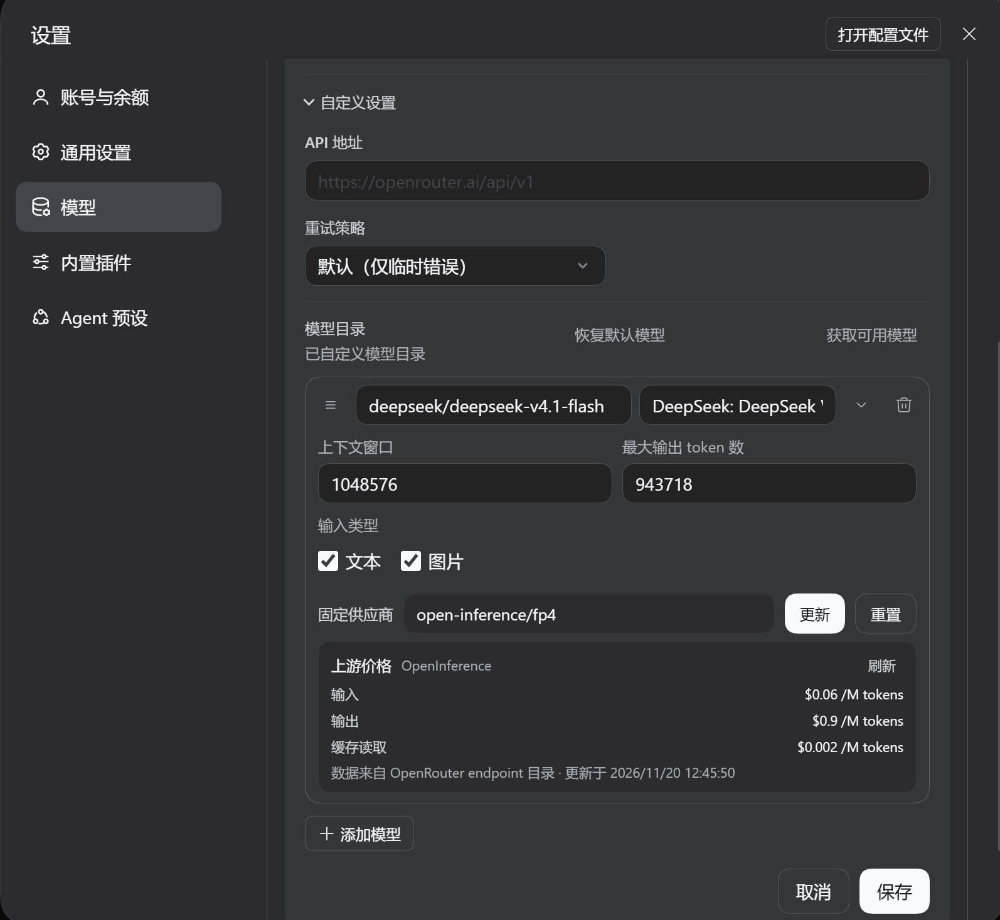

# dsh-spend-pin · 金额计算与固定供应商

在 DSH 自己的 **设置 → 模型** 里给每个 OpenRouter 模型固定上游 endpoint，并按实际供应商价格计算每个会话的 CNY/USD 花费；模型行「输入类型」下面同时显示这个 endpoint 的实时价格。



*截图：DSH 0.2.2-rc.5 的「设置 → 模型」，模型行展开后补出的固定供应商输入框与上游价格块。*

> 已在 **DSH 0.2.1-rc.2** 与 **0.2.2-rc.5** 上测试。

这一版不再自己添加提供商、不再收 API 密钥。OpenRouter 一律用原生「添加模型提供商 / 编辑」管理；插件只做三件事：

1. 在原生模型行里补一行 **固定供应商**（手填 endpoint tag + 更新 / 重置）；
2. 把 **上游价格块** 放在这一行下面；
3. 按这个价格（或未固定模型自动取到的会话价）算每轮和整个会话的金额。

## 用法

1. **设置 → 模型**，用原生「添加模型提供商」加 OpenRouter（或编辑已有的 `openrouter`）。
2. 展开卡片里的 **自定义设置 → 模型目录**，点某个模型行右侧的展开箭头。
3. 在「输入类型」下面就是插件补的两块：**固定供应商**（输入框 + 更新 / 重置）和 **上游价格** 块（输入 / 输出 / 缓存读取，带数据来源和更新时间）。

4. 填 `deepinfra/fp8`，点 **更新**。写入立即生效，**不需要**再点原生卡片的「保存」；原生「保存」也不会因为插件写入而报冲突。
5. **重置** 或把输入框清空再更新，回到 OpenRouter 自动选路，同时清掉该模型的价格对比基线。

每个模型行各自固定，互不影响；同一个提供商下不同模型可以指向不同上游。

## 存在哪里

插件自己的设置命名空间 `spend-pin`（profile 的 `cordis.patch.yml`）：

```yaml
- id: spend-pin
  config:
    pins:
      deepseek/deepseek-v4.1-flash-1017: deepinfra/fp8
```

**为什么不用提供商 profile 的 `headers`**：原生 `ProviderEditor` 打开时抓住当时的 `revision`，保存时用它做乐观锁。插件在编辑器打开期间往 `llm-pi-ai` 写任何字段，它的「保存」都会报 `settings/conflict`，必须关掉重开。pin 放在独立命名空间里，有自己的 revision，完全不碰那把锁。

因为 pin 表只有这一处，删除整个 OpenRouter 提供商时可以一次清空，不遍历、不拉网络。

## 请求怎么被改写

`provider.only` / `quantizations` / `allow_fallbacks` 是 OpenRouter **请求体**字段，`dsh-llm-pi-ai` 在 compat 闸门里把它们标成 `withhold`，配置层写不进去。所以 host 半边包了一层 `globalThis.fetch`，只对同时满足这些条件的请求做改写：

- URL 的 host 是 `openrouter.ai` 或子域；
- 方法 POST，body 是带字符串 `model` 的 JSON 对象；
- `pins` 表里有这个 `model`。

改写内容：body 里合并

```json
{ "provider": { "only": ["deepinfra"], "quantizations": ["fp8"], "allow_fallbacks": false } }
```

endpoint tag 的映射规则：

| 填写 | 实际发送的 `provider` |
| --- | --- |
| `deepinfra/fp8` | `{ only: ["deepinfra"], quantizations: ["fp8"], allow_fallbacks: false }` |
| `deepinfra` | `{ only: ["deepinfra"], allow_fallbacks: false }` |
| `deepinfra/fp8/priority` | `{ only: ["deepinfra/fp8/priority"], allow_fallbacks: false }` |
| 留空 | 不注入，OpenRouter 自动选路 |

其它任何请求（模型发现、别的适配器、web 抓取）原样放行；插件卸载时恢复原 fetch。

## 删除 OpenRouter 提供商时

每次 `llm-pi-ai` 设置推送，host 半边做一次很轻的检查：

- 还有 `providers.openrouter`（或任何 `baseURL` 指向 `openrouter.ai` 的路由）→ 什么都不做；
- 一个都没有了 → `pins` 表一次写成 `{}`，把旧的固定关系清掉；
- 如果这次清理写失败 → 本进程内不再应用任何 pin；提供商重新出现时，只有 pin 表确实为空才恢复应用，避免新添加的 OpenRouter 继承旧模型上的 pin。

**刻意没有启动时检查**：启动路径不读设置、不写配置。代价是：如果在 DSH 没运行时删掉了 OpenRouter（改 patch、换 profile），再启动不会补查，旧 `pins` 会留在配置里；之后重新添加同 id 的 OpenRouter 时可能生效。遇到这种情况点一次 **重置**，或手动清掉 `pins` 即可。

## 价格与金额

- 价格数据源是 OpenRouter 公开的 endpoint 目录，浏览器直连（CORS 允许），**只有点开模型行或点刷新时才拉**。
- 每个模型行按 **model + endpoint tag** 记录上次价格到浏览器 `localStorage`（键 `dsh-spend-pin:last-price`）。价格变动显示 `$old → $new`（涨价标红、降价标绿），并且一直保留，直到下一次变动。
- 请求带 cache-buster 与 `cache: 'no-store'`，避免 CDN 的旧目录伪造一次价格变动。
- 未固定时改为显示“实际路由”框（见下）；拉取失败降级成提示，不影响输入和按钮。

### 金额怎么算（价格框是主，金额是从）

- **DS 官方**：按内置 CNY 峰谷价格表，和以前一样。
- **固定供应商**：宿主启动时并行拉一次 endpoint 目录价（带重试），写进内存价格簿；之后点开/刷新框也会更新同一份价格。金额按这份价 × token。
- **未固定供应商**：自动管线，和需要你点开的框是两套东西。宿主按 `x-session-id` 记下**每个会话**实际路由到的供应商；会话里的金额组件自动取该供应商的 endpoint 价，按 **会话+模型+供应商** 去重，写成会话级价格。之后该会话的 USD 都按这个价算。不需要你点框。
- USD 金额由宿主只读路由 `GET /spend-pin/api/spend?sessions=…` 读取账本。第一条消息第一次拿到价时，按 `tokens ×（会话价 ?? 启动价）` 算好 USD 并写回该条账本（`usd`）；之后只读这个存档，价格再变也不重算。之前是问号、后来才拿到价的历史消息，会在下一次读取时补算一次并同样存档。
- **压缩摘要**：DSH 的 `compaction/summary` 事件自带 `usage` 和 `provider/model`，按同一条价格路径计入该轮（不需要问 OpenRouter）；该轮的花费面板在模型下面显示 `压缩摘要*N`，N = 这一轮的摘要次数。
- **总花费**只显示已经算出来的钱：USD 一行如果全是问号就直接不显示，部分算出来时只显示已知金额，不带问号；压缩摘要次数只出现在单轮面板，不进总花费。
- **生命周期**：会话价和启动价都在**宿主进程内存**里——刷新页面、client 插件热更新都不丢，半截会话的后半段还能接着算；只有关闭/重启 DSH 才丢，之后下一条消息会自动重新观测、重新取价。

### 未固定供应商时的“实际路由”框

没有填固定供应商的模型行，在展开后如果宿主已经知道它最近路由到谁，就在「固定供应商」下面显示「上游价格」框：

- 供应商来自 OpenRouter **流式响应的第一个 chunk**。每个 chunk 都带 `provider`（例如 `Cloudflare`），所以第一块到手就知道是谁在服务；
- 宿主按 model 记住最近一次，同一供应商去重；设置页**只在展开这个模型行时读一次**（没有定时器、没有 focus/visibility 监听）；
- 价格仍从 endpoint 目录按 `provider_name` 匹配；同一供应商有多个 endpoint 时取 tag 段数最少（最接近标准）的那个；
- **不落盘**：不写 `localStorage`、不写 settings、不写文件。host 只在本进程内存里留一份观测（只读路由 `GET /spend-pin/api/upstream`），client 只接受**本次页面加载之后**的观测。所以刷新页面或重启 DSH 后框就空了，直到本页里该模型再收到一条回复；
- 请求在第一个 chunk 之前就超时/失败时没有观测，这次展开就不显示框。
- 这里“刷新就空”只指这个**显示框**；该会话的金额是上面自动管线按宿主内存里的会话价算的，刷新页面/HMR 不会丢。

## 已知边界

- **模型行内部没有官方 slot**。`settings.models.provider-card` 在编辑器上方，`settings.models.footer` 在整页末尾，都不在「输入类型」下面。所以插件注册 provider-card 席位只为拿到 route id，然后用一次 DOM 锚点把 React portal 插到输入类型 fieldset 后面。原生模型行结构如果大改，这一行可能不出现；实现上会安静降级，不会破坏原生卡片。
- pin 按 **model id** 存。所有指向 OpenRouter 的路由共用这张表；同一个模型如果同时挂在两个 OpenRouter 路由下，改一处会影响两处。
- `dsh-session-cost` 之前靠抓出站请求上的 `x-dsh-spend-pin` 头来学习 pin；这一版不再发这个头，所以它不会看到新的 pin（已记录的 pin 仍在，价格回退到目录价）。需要的话可以给它加一条读取插件配置的通道。
- host 半边改完要重启一次 `dsh web`（或在设置 → 插件里把本 bundle 关再开一次）才生效；client 半边刷新页面即可。改 client 后不需要重装 bundle（profile 里是 link）。

## 从 v1 升级

- v1 的三行卡片、自建路由、`OPENROUTER_PINNED_API_KEY`、自动写推理、usage 补零全部删除。
- 旧卡片写入的 `llm-pi-ai` 路由不会自动迁移到新表；把模型加到原生 OpenRouter 提供商后重新填一次固定即可。

## 文件

| 文件 | 作用 |
| --- | --- |
| `index.js` | host 半边：`Config.pins`、fetch 改写、供应商观测、价格簿、USD 金额路由、删除提供商时的清理 |
| `client.js` | client 半边：provider-card 标记 + 模型行 DOM 锚点 + 固定/实际路由价格块 + 金额胶囊 |
| `cordis.patch.yml` | bundle 插入的 host 行 `spend-pin` |
| `locale/*.json` | 插件管理器里的标题/描述 |
| `icon.svg` | 自绘图标 |
| `check-host.mjs` | 纯函数、fetch 改写、供应商观测与只读路由、删除清理（`node check-host.mjs`） |
| `check-pricing.mjs` | 从 `client.js` 原样抽出定价辅助函数，核对线上目录（`node check-pricing.mjs`） |
| `check-storage.mjs` | 从 `client.js` 原样抽出价格记录辅助函数（`node check-storage.mjs`） |

```powershell
node check-host.mjs
node check-pricing.mjs
node check-storage.mjs
```
